<a href="https://neel-os.vercel.app"><picture><source media="(prefers-color-scheme: dark)" srcset="assets/v3/hero-d.svg"></picture></a>

<picture><source media="(prefers-color-scheme: dark)" srcset="assets/v3/marquee-d.svg"></picture>

<p align="right"><sub><a href="https://neel-os.vercel.app">neel-os.vercel.app&nbsp;&#8599;</a> &nbsp;&nbsp; <a href="https://www.linkedin.com/in/neelkachhadia/">LinkedIn&nbsp;&#8599;</a></sub></p>

<br>

<picture><source media="(prefers-color-scheme: dark)" srcset="assets/v3/sec-02-d.svg"></picture>
<a href="https://github.com/Neel-Kachhadia/ARTC"><picture><source media="(prefers-color-scheme: dark)" srcset="assets/v3/row-01-d.svg"></picture></a>
<a href="https://github.com/Neel-Kachhadia/InferScale"><picture><source media="(prefers-color-scheme: dark)" srcset="assets/v3/row-02-d.svg"></picture></a>
<a href="https://github.com/Neel-Kachhadia/KavachPay"><picture><source media="(prefers-color-scheme: dark)" srcset="assets/v3/row-03-d.svg"></picture></a>
<a href="https://github.com/Neel-Kachhadia/indian-terminal"><picture><source media="(prefers-color-scheme: dark)" srcset="assets/v3/row-04-d.svg"></picture></a>
<a href="https://github.com/Neel-Kachhadia/FleetRight"><picture><source media="(prefers-color-scheme: dark)" srcset="assets/v3/row-05-d.svg"></picture></a>
<a href="https://github.com/Neel-Kachhadia/NeuroFin"><picture><source media="(prefers-color-scheme: dark)" srcset="assets/v3/row-06-d.svg"></picture></a>

<br><br>

<picture><source media="(prefers-color-scheme: dark)" srcset="assets/v3/sec-03-d.svg"></picture>

<picture><source media="(prefers-color-scheme: dark)" srcset="assets/v3/pager-d.svg"></picture>

Your phone buzzes at 02:47. Checkout p99 went from **38 ms to 1,912 ms** and 4% of payments are timing out. You have fifteen minutes of error budget. Every wrong move costs time.

<details>
<summary><b>Acknowledge the page</b></summary>
<blockquote>

You open your laptop. Three things you could do first:

<details>
<summary><b>A</b> &nbsp; Restart every checkout pod</summary>
<blockquote>

Pods cycle, caches go cold, p99 hits 4 s for two minutes and then settles back at 1.9 s. Nothing fixed. **−5 min.** <sub>Close this and choose again.</sub>

</blockquote>
</details>

<details>
<summary><b>B</b> &nbsp; Roll back last night's 23:10 deploy</summary>
<blockquote>

The rollback takes six minutes. p99 doesn't move. The deploy only touched email templates. **−6 min.** <sub>Close this and choose again.</sub>

</blockquote>
</details>

<details>
<summary><b>C</b> &nbsp; Break the latency down by dependency</summary>
<blockquote>

You pull a trace for a slow request.

```text
span                         p50        p99
checkout-api  handler        4 ms   1,912 ms
├─ auth       (gRPC)         2 ms       3 ms
├─ inventory  (gRPC)         3 ms   1,890 ms   ◀
└─ payments   (HTTP)         9 ms      14 ms
```

It's inventory. It runs three replicas behind a round-robin client. You split the numbers per replica:

```text
replica   p99        cpu    gc pause
inv-a     6 ms       31%    2 ms
inv-b     5 ms       29%    3 ms
inv-c     1,940 ms   97%    410 ms   ◀
```

<details>
<summary><b>A</b> &nbsp; Scale inventory from 3 to 6 replicas</summary>
<blockquote>

Round-robin still sends one request in six to inv-c, and every checkout calls inventory several times. p99 barely moves. **−4 min.** <sub>Close this and choose again.</sub>

</blockquote>
</details>

<details>
<summary><b>B</b> &nbsp; Raise the client timeout to 5 s</summary>
<blockquote>

Fewer errors, slower everything. Requests now wait on inv-c instead of failing fast. Customers notice. **−3 min.** <sub>Close this and choose again.</sub>

</blockquote>
</details>

<details>
<summary><b>C</b> &nbsp; Pull inv-c out of rotation</summary>
<blockquote>

Thirty seconds later p99 is back to **41 ms**. Bleeding stopped. But you don't close an incident without knowing why. inv-c's heap tells a story:

```text
heap since 23:10
inv-a   ▃▃▃▃▃▃▃▃▃▃▃▃
inv-b   ▃▃▃▃▃▃▃▃▃▃▃▃
inv-c   ▁▂▂▃▄▄▅▆▆▇▇█   ◀ climbing for 3.5 hours
```

What's different about inv-c?

<details>
<summary><b>A</b> &nbsp; It landed on a noisy host</summary>
<blockquote>

You check the node. Neighbours are idle and disk is quiet. A noisy host doesn't grow a heap. **−2 min.** <sub>Close this and choose again.</sub>

</blockquote>
</details>

<details>
<summary><b>B</b> &nbsp; It's running a different build</summary>
<blockquote>

**Found it.** inv-c was the canary for inventory build `7f3c`, which also shipped at 23:10. It added a lookup cache with no eviction. The heap grew until GC ate the CPU, and one sick replica owned the whole p99.

**Incident resolved.** The fastest path is C → C → B, about 4 minutes. Count the minutes you lost on the way to see how you did.

---

Postmortem note: the fix wasn't more replicas. It was routing around the slow one. That's the problem I built **[ARTC](https://github.com/Neel-Kachhadia/ARTC)** to solve: replica-health selection, deadline-aware admission and bounded hedging, so a client steps around an inv-c by itself at 02:47 while you sleep. It held **p99 1.73 ms across 900,000 requests**.

If you like this kind of problem, [let's talk](https://www.linkedin.com/in/neelkachhadia/).

</blockquote>
</details>

<details>
<summary><b>C</b> &nbsp; Cosmic rays</summary>
<blockquote>

Respect. But no. **−1 min.** <sub>Close this and choose again.</sub>

</blockquote>
</details>

</blockquote>
</details>

</blockquote>
</details>

</blockquote>
</details>

</blockquote>
</details>

<br>

<picture><source media="(prefers-color-scheme: dark)" srcset="assets/v3/sec-04-d.svg"></picture>

<p align="center"><sub><a href="https://github.com/Neel-Kachhadia/Neel-Kachhadia/issues/new?title=wave&body=Press%20**Create**.%20Your%20avatar%20joins%20the%20page%20in%20about%2030%20seconds.">Sign the guestbook&nbsp;&#8599;</a> &nbsp; Your avatar stays on this page.</sub></p>

<!--WALL:START-->

<p align="center"><sub>Nobody yet. Be the first.</sub></p>

<!--WALL:END-->

<br>

<details>
<summary><sub>COLOPHON</sub></summary>
<br>

Set in Instrument Serif and JetBrains Mono, subset and embedded in hand-written SVG. The portrait is my avatar, cut out and reduced to 1-bit with Floyd–Steinberg dithering. Every piece adapts to light and dark mode.

The incident is plain Markdown: nested `<details>` and nothing else, so it runs instantly anywhere GitHub renders. The guestbook is live: signing it opens an issue, and a GitHub Action adds your avatar, rewrites this README and closes the issue. The source is in [`arcade/`](arcade/arcade.py).

The longer version of all this lives at [neel-os.vercel.app](https://neel-os.vercel.app).

</details>
