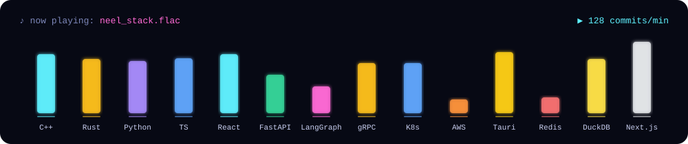

☝️ that's my portfolio, rebuilt as an operating system. Go click around.

 

## 🎮 This profile is alive. Play with it.

<h3 align="center">⚔️ Beat my AI</h3>

Tic-tac-toe vs a minimax agent that has never lost. Click any ⬜. It opens an issue; hit <b>Create</b> and the board updates in ~30s.

<!--GAME:START-->

<table align="center"><tr><td align="center" width="64" height="64"><h2>⭕</h2></td><td align="center" width="64" height="64"><h2><a href="https://github.com/Neel-Kachhadia/Neel-Kachhadia/issues/new?title=ttt%7C1&body=Just%20press%20%2A%2ACreate%2A%2A%20%F0%9F%91%87.%20The%20arcade%20bot%20replies%20in%20about%2030%20seconds%20and%20the%20board%20on%20the%20profile%20updates.">⬜</a></h2></td><td align="center" width="64" height="64"><h2><a href="https://github.com/Neel-Kachhadia/Neel-Kachhadia/issues/new?title=ttt%7C2&body=Just%20press%20%2A%2ACreate%2A%2A%20%F0%9F%91%87.%20The%20arcade%20bot%20replies%20in%20about%2030%20seconds%20and%20the%20board%20on%20the%20profile%20updates.">⬜</a></h2></td></tr>
<tr><td align="center" width="64" height="64"><h2><a href="https://github.com/Neel-Kachhadia/Neel-Kachhadia/issues/new?title=ttt%7C3&body=Just%20press%20%2A%2ACreate%2A%2A%20%F0%9F%91%87.%20The%20arcade%20bot%20replies%20in%20about%2030%20seconds%20and%20the%20board%20on%20the%20profile%20updates.">⬜</a></h2></td><td align="center" width="64" height="64"><h2>❌</h2></td><td align="center" width="64" height="64"><h2><a href="https://github.com/Neel-Kachhadia/Neel-Kachhadia/issues/new?title=ttt%7C5&body=Just%20press%20%2A%2ACreate%2A%2A%20%F0%9F%91%87.%20The%20arcade%20bot%20replies%20in%20about%2030%20seconds%20and%20the%20board%20on%20the%20profile%20updates.">⬜</a></h2></td></tr>
<tr><td align="center" width="64" height="64"><h2><a href="https://github.com/Neel-Kachhadia/Neel-Kachhadia/issues/new?title=ttt%7C6&body=Just%20press%20%2A%2ACreate%2A%2A%20%F0%9F%91%87.%20The%20arcade%20bot%20replies%20in%20about%2030%20seconds%20and%20the%20board%20on%20the%20profile%20updates.">⬜</a></h2></td><td align="center" width="64" height="64"><h2><a href="https://github.com/Neel-Kachhadia/Neel-Kachhadia/issues/new?title=ttt%7C7&body=Just%20press%20%2A%2ACreate%2A%2A%20%F0%9F%91%87.%20The%20arcade%20bot%20replies%20in%20about%2030%20seconds%20and%20the%20board%20on%20the%20profile%20updates.">⬜</a></h2></td><td align="center" width="64" height="64"><h2><a href="https://github.com/Neel-Kachhadia/Neel-Kachhadia/issues/new?title=ttt%7C8&body=Just%20press%20%2A%2ACreate%2A%2A%20%F0%9F%91%87.%20The%20arcade%20bot%20replies%20in%20about%2030%20seconds%20and%20the%20board%20on%20the%20profile%20updates.">⬜</a></h2></td></tr></table>

Last move by <b>@Neel-Kachhadia</b>. Anyone can continue this game!

<b>Humans 🏆 0</b> &nbsp;·&nbsp; Draws 🤝 0 &nbsp;·&nbsp; AI 🤖 0 &nbsp;·&nbsp; 0 games played

Recent: <i>No games yet. Be the first!</i>

<!--GAME:END-->

<h3 align="center">🗳️ You decide what I build next</h3>

The winner becomes my next open-source project.

<!--POLL:START-->

| | Vote | Momentum |
|:--|:--:|:--|
| ⚡ C++ low-latency backtesting engine | [**Vote →**](https://github.com/Neel-Kachhadia/Neel-Kachhadia/issues/new?title=vote%7Cquant&body=Press%20%2A%2ACreate%2A%2A%20to%20cast%20your%20vote%20%F0%9F%97%B3%EF%B8%8F.%20One%20vote%20per%20person.) | `░░░░░░░░░░░░` 0 |
| 🦀 Rust key-value store with Raft | [**Vote →**](https://github.com/Neel-Kachhadia/Neel-Kachhadia/issues/new?title=vote%7Craft&body=Press%20%2A%2ACreate%2A%2A%20to%20cast%20your%20vote%20%F0%9F%97%B3%EF%B8%8F.%20One%20vote%20per%20person.) | `░░░░░░░░░░░░` 0 |
| 🧠 Multi-agent research OS | [**Vote →**](https://github.com/Neel-Kachhadia/Neel-Kachhadia/issues/new?title=vote%7Cagents&body=Press%20%2A%2ACreate%2A%2A%20to%20cast%20your%20vote%20%F0%9F%97%B3%EF%B8%8F.%20One%20vote%20per%20person.) | `░░░░░░░░░░░░` 0 |
| 🎛️ GPU cluster scheduler for LLMs | [**Vote →**](https://github.com/Neel-Kachhadia/Neel-Kachhadia/issues/new?title=vote%7Cgpu&body=Press%20%2A%2ACreate%2A%2A%20to%20cast%20your%20vote%20%F0%9F%97%B3%EF%B8%8F.%20One%20vote%20per%20person.) | `░░░░░░░░░░░░` 0 |

<!--POLL:END-->

<h3 align="center">👋 The Visitor Wall</h3>

Leave your mark: <a href="https://github.com/Neel-Kachhadia/Neel-Kachhadia/issues/new?title=wave&body=Press%20**Create**%20and%20your%20avatar%20joins%20the%20wall%20%F0%9F%91%8B">click here to wave</a>, and your avatar appears below forever (well, until 30 newer people wave).

<!--WALL:START-->

<i>The wall is empty... for now.</i>

<!--WALL:END-->

## 🕹️ Enter the Machine &nbsp;a text adventure through my work

> *You wake up inside a humming server rack. Four doors glow in the dark. Somewhere, a vault is waiting for the four key fragments.*

<b>🚪 Door 1: the room where every millisecond is taxed</b>

<blockquote>

Thousands of RPCs scream past you. Some replicas are slow, some are dying. A calm traffic controller decides, in microseconds, where each request goes, when to hedge, and when to say no.

This is **[ARTC](https://github.com/Neel-Kachhadia/ARTC)**, my C++23 gRPC tail-latency controller. It survived a one-hour soak: **900,000 / 900,000 requests, p99 1.73 ms**, zero rejections.

🔦 Look behind the server

<blockquote>

A sticky note: *"CPU utilization is telemetry, not proof."* It's signed by **[FleetRight](https://github.com/Neel-Kachhadia/FleetRight)**, a capacity planner that shrinks Kubernetes fleets only when a C++ verifier proves p99 still holds.

🗝️ **You found key fragment #1: `B`**
</blockquote>

</blockquote>

<b>🚪 Door 2: the room full of warm GPUs</b>

<blockquote>

A single RTX 4060 hums. Dozens of prompts wait in line, and some of them are impatient humans. A scheduler hands out service credits, ages old requests and protects decoding streams.

This is **[InferScale](https://github.com/Neel-Kachhadia/InferScale)**, my C++20 LLM inference runtime. Its SA-WDS scheduler cut interactive TTFT p99 from **471 ms to 442 ms**, and the trade-offs are documented honestly.

🔦 Read the log on the screen

<blockquote>

`151 of 156 benchmark arms marked INVALID_THERMAL.` Rule #1 of benchmarking: the laptop fan is part of the experiment. 🌡️

🗝️ **You found key fragment #2: `U`**
</blockquote>

</blockquote>

<b>🚪 Door 3: a vault guarded by an AI with a credit card</b>

<blockquote>

An AI agent wants to buy something. It doesn't get a card. It gets a **cryptographically signed mandate**: how much, where, until when. A two-phase reservation engine makes sure ten parallel agents can't overspend the same budget.

This is **[KavachPay](https://github.com/Neel-Kachhadia/KavachPay)**: *"Authority is not access. It is a bound contract."*

🔦 Try to bribe the guard

<blockquote>

The guard prints a signed decision receipt: `DENY: negative constraint violated`. Nice try. 😏

🗝️ **You found key fragment #3: `I`**
</blockquote>

</blockquote>

<b>🚪 Door 4: a trading floor that fits inside a laptop</b>

<blockquote>

NIFTY ticks stream in live. Option chains, Greeks, an IV surface rotating in 3D, futures basis, screeners, all local-first in a Rust + Tauri shell with a Python analytics brain.

This is **[BharatTerminal](https://github.com/Neel-Kachhadia/indian-terminal)**, a research terminal for Indian equities & F&O.

🔦 Check the drawer

<blockquote>

You find the blueprints of where it all began: **[NeuroFin](https://github.com/Neel-Kachhadia/NeuroFin)** (an agentic finance co-pilot, [demo 🎥](https://youtu.be/e44duKUrC7k)) and an **[Equity Research](https://github.com/Neel-Kachhadia/Equity-research-platform)** platform built on LangGraph.

🗝️ **You found key fragment #4: `L`**
</blockquote>

</blockquote>

<b>🔐 The Vault: enter the 4 fragments</b>

<blockquote>

<code>U I L B</code> ❌

<blockquote>🚨 Access denied. Order matters. Try the doors again.</blockquote>

<code>L I B U</code> ❌

<blockquote>🚨 Access denied. That's not even a word.</blockquote>

<code>B U I L</code> ✅

<blockquote>

🔓 *The vault hisses open...*

**...D.** The last fragment was always yours to bring.

You made it to the end of the machine, which puts you in the rare 1% of profile visitors. If you're hiring, building something ambitious, or just want to talk systems / AI / markets:

### → [Let's build something together](https://www.linkedin.com/in/neelkachhadia/)

P.S. Tell me you found the vault. I'll know you're the curious type. 🫡
</blockquote>

</blockquote>

## 🎧 The Stack

<b>🧪 Run <code>neel --stats</code></b>

 

<b>🚫 Do not click this</b>

<blockquote>

Seriously. Don't.

<blockquote>

OK, last warning. ⚠️

<blockquote>

You really don't follow instructions, huh?

<blockquote>

🏆 **Achievement unlocked: _Curiosity > Compliance_**

That's exactly the trait I look for in teammates. Now go [beat my AI](#-beat-my-ai) ⬆️

</blockquote>

</blockquote>

</blockquote>

</blockquote>

 
<code>// this README is updated by a GitHub Action every time someone plays. it's never the same twice.</code>

