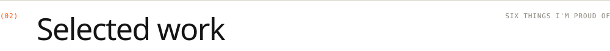
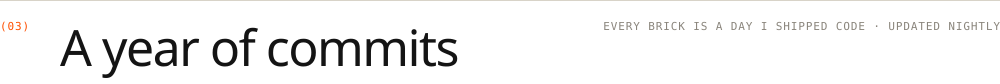

<a href="https://neel-os.vercel.app"><picture><source media="(prefers-color-scheme: dark)" srcset="assets/v3/hero-v3-d.svg"></picture></a>

<a href="https://www.linkedin.com/in/neelkachhadia/"><picture><source media="(prefers-color-scheme: dark)" srcset="assets/v3/btn-linkedin-v2-d.svg"></picture></a>&nbsp;&nbsp;<a href="https://neel-os.vercel.app"><picture><source media="(prefers-color-scheme: dark)" srcset="assets/v3/btn-portfolio-v2-d.svg"></picture></a>

<picture><source media="(prefers-color-scheme: dark)" srcset="assets/v3/marquee-v3-d.svg"></picture>

 

<picture><source media="(prefers-color-scheme: dark)" srcset="assets/v3/sec-02-v3-d.svg"></picture>
<a href="https://github.com/Neel-Kachhadia/ARTC"><picture><source media="(prefers-color-scheme: dark)" srcset="assets/v3/row-01-v3-d.svg"></picture></a>
<a href="https://github.com/Neel-Kachhadia/InferScale"><picture><source media="(prefers-color-scheme: dark)" srcset="assets/v3/row-02-v3-d.svg"></picture></a>
<a href="https://github.com/Neel-Kachhadia/KavachPay"><picture><source media="(prefers-color-scheme: dark)" srcset="assets/v3/row-03-v3-d.svg"></picture></a>
<a href="https://github.com/Neel-Kachhadia/indian-terminal"><picture><source media="(prefers-color-scheme: dark)" srcset="assets/v3/row-04-v3-d.svg"></picture></a>
<a href="https://github.com/Neel-Kachhadia/FleetRight"><picture><source media="(prefers-color-scheme: dark)" srcset="assets/v3/row-05-v3-d.svg"></picture></a>
<a href="https://github.com/Neel-Kachhadia/NeuroFin"><picture><source media="(prefers-color-scheme: dark)" srcset="assets/v3/row-06-v3-d.svg"></picture></a>

  

<picture><source media="(prefers-color-scheme: dark)" srcset="assets/v3/sec-03-commits-v3-d.svg"></picture>

<picture>
  <source media="(prefers-color-scheme: dark)" srcset="https://raw.githubusercontent.com/Neel-Kachhadia/Neel-Kachhadia/output/breakout-contribution-graph-dark.svg">
  
</picture>

My GitHub contribution graph, played as Breakout.

