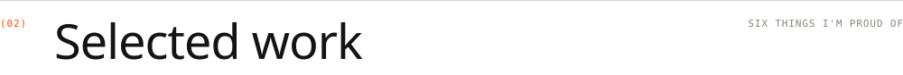
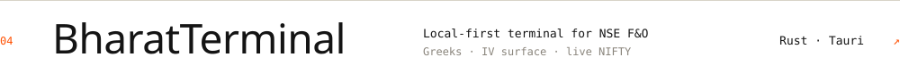
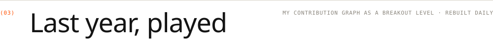

<a href="https://neel-os.vercel.app"><picture><source media="(prefers-color-scheme: dark)" srcset="assets/v3/hero-d.svg"></picture></a>

<picture><source media="(prefers-color-scheme: dark)" srcset="assets/v3/marquee-d.svg"></picture>

<a href="https://neel-os.vercel.app">neel-os.vercel.app&nbsp;&#8599;</a> &nbsp;&nbsp; <a href="https://www.linkedin.com/in/neelkachhadia/">LinkedIn&nbsp;&#8599;</a>

 

<picture><source media="(prefers-color-scheme: dark)" srcset="assets/v3/sec-02-d.svg"></picture>
<a href="https://github.com/Neel-Kachhadia/ARTC"><picture><source media="(prefers-color-scheme: dark)" srcset="assets/v3/row-01-d.svg"></picture></a>
<a href="https://github.com/Neel-Kachhadia/InferScale"><picture><source media="(prefers-color-scheme: dark)" srcset="assets/v3/row-02-d.svg"></picture></a>
<a href="https://github.com/Neel-Kachhadia/KavachPay"><picture><source media="(prefers-color-scheme: dark)" srcset="assets/v3/row-03-d.svg"></picture></a>
<a href="https://github.com/Neel-Kachhadia/indian-terminal"><picture><source media="(prefers-color-scheme: dark)" srcset="assets/v3/row-04-d.svg"></picture></a>
<a href="https://github.com/Neel-Kachhadia/FleetRight"><picture><source media="(prefers-color-scheme: dark)" srcset="assets/v3/row-05-d.svg"></picture></a>
<a href="https://github.com/Neel-Kachhadia/NeuroFin"><picture><source media="(prefers-color-scheme: dark)" srcset="assets/v3/row-06-d.svg"></picture></a>

  

<picture><source media="(prefers-color-scheme: dark)" srcset="assets/v3/sec-03-d.svg"></picture>

<!--GAME:START-->

<picture><source media="(prefers-color-scheme: dark)" srcset="assets/v3/cell-0-o-d.svg"></picture><a href="https://github.com/Neel-Kachhadia/Neel-Kachhadia/issues/new?title=ttt%7C1&body=Press%20%2A%2ACreate%2A%2A.%20A%20bot%20plays%20the%20reply%20and%20updates%20the%20board%20on%20the%20profile%20in%20about%2030%20seconds."><picture><source media="(prefers-color-scheme: dark)" srcset="assets/v3/cell-1-e-d.svg"></picture></a><a href="https://github.com/Neel-Kachhadia/Neel-Kachhadia/issues/new?title=ttt%7C2&body=Press%20%2A%2ACreate%2A%2A.%20A%20bot%20plays%20the%20reply%20and%20updates%20the%20board%20on%20the%20profile%20in%20about%2030%20seconds."><picture><source media="(prefers-color-scheme: dark)" srcset="assets/v3/cell-2-e-d.svg"></picture></a> <a href="https://github.com/Neel-Kachhadia/Neel-Kachhadia/issues/new?title=ttt%7C3&body=Press%20%2A%2ACreate%2A%2A.%20A%20bot%20plays%20the%20reply%20and%20updates%20the%20board%20on%20the%20profile%20in%20about%2030%20seconds."><picture><source media="(prefers-color-scheme: dark)" srcset="assets/v3/cell-3-e-d.svg"></picture></a><picture><source media="(prefers-color-scheme: dark)" srcset="assets/v3/cell-4-x-d.svg"></picture><a href="https://github.com/Neel-Kachhadia/Neel-Kachhadia/issues/new?title=ttt%7C5&body=Press%20%2A%2ACreate%2A%2A.%20A%20bot%20plays%20the%20reply%20and%20updates%20the%20board%20on%20the%20profile%20in%20about%2030%20seconds."><picture><source media="(prefers-color-scheme: dark)" srcset="assets/v3/cell-5-e-d.svg"></picture></a> <a href="https://github.com/Neel-Kachhadia/Neel-Kachhadia/issues/new?title=ttt%7C6&body=Press%20%2A%2ACreate%2A%2A.%20A%20bot%20plays%20the%20reply%20and%20updates%20the%20board%20on%20the%20profile%20in%20about%2030%20seconds."><picture><source media="(prefers-color-scheme: dark)" srcset="assets/v3/cell-6-e-d.svg"></picture></a><a href="https://github.com/Neel-Kachhadia/Neel-Kachhadia/issues/new?title=ttt%7C7&body=Press%20%2A%2ACreate%2A%2A.%20A%20bot%20plays%20the%20reply%20and%20updates%20the%20board%20on%20the%20profile%20in%20about%2030%20seconds."><picture><source media="(prefers-color-scheme: dark)" srcset="assets/v3/cell-7-e-d.svg"></picture></a><a href="https://github.com/Neel-Kachhadia/Neel-Kachhadia/issues/new?title=ttt%7C8&body=Press%20%2A%2ACreate%2A%2A.%20A%20bot%20plays%20the%20reply%20and%20updates%20the%20board%20on%20the%20profile%20in%20about%2030%20seconds."><picture><source media="(prefers-color-scheme: dark)" srcset="assets/v3/cell-8-e-d.svg"></picture></a>

Game in progress. Last move by <a href="https://github.com/Neel-Kachhadia">@Neel-Kachhadia</a>. Anyone can continue it.

HUMANS 0 &nbsp;&middot;&nbsp; MACHINE 0 &nbsp;&middot;&nbsp; DRAWS 0

<!--GAME:END-->

 

<picture><source media="(prefers-color-scheme: dark)" srcset="assets/v3/sec-04-d.svg"></picture>

<a href="https://github.com/Neel-Kachhadia/Neel-Kachhadia/issues/new?title=wave&body=Press%20**Create**.%20Your%20avatar%20joins%20the%20page%20in%20about%2030%20seconds.">Sign the guestbook&nbsp;&#8599;</a> &nbsp; Your avatar stays on this page.

<!--WALL:START-->

Nobody yet. Be the first.

<!--WALL:END-->

 

COLOPHON

 

Set in Instrument Serif and JetBrains Mono, subset and embedded in hand-written SVG. The portrait is my avatar, cut out and reduced to 1-bit with Floyd–Steinberg dithering. Every piece adapts to light and dark mode.

The board is real. Clicking a square opens an issue; a GitHub Action reads it, lets a minimax opponent reply, rewrites this README and closes the issue. The source is in [`arcade/`](arcade/arcade.py).

The longer version of all this lives at [neel-os.vercel.app](https://neel-os.vercel.app).

