<div align="center">




<br/>

<a href="https://www.linkedin.com/in/neelkachhadia/"></a>


</div>

```diff
@@  NEEL.K  ·  ANALYST SUMMARY                                        @@
+ Engineering student building systems where money, models and milliseconds meet.
+ From agentic payment guardrails and F&O analytics terminals
+ to C++ RPC routers, LLM inference runtimes and SLO-driven capacity planners.
! Thesis: measured evidence > marketing. Every benchmark ships with its limitations.
```

---

### 💼 Portfolio Holdings

| Ticker | Position | Sector | Key metric | Stack |
|:--|:--|:--|:--|:--|
| **`$KVCH`** | [KavachPay](https://github.com/Neel-Kachhadia/KavachPay) | 🛡️ Agentic payments | Signed mandates · atomic spend walls | `Next.js` `Node` `TS` |
| **`$BHRT`** | [BharatTerminal](https://github.com/Neel-Kachhadia/indian-terminal) | 📈 Indian F&O analytics | Greeks · IV surface · skew | `Tauri` `Rust` `FastAPI` |
| **`$ARTC`** | [ARTC](https://github.com/Neel-Kachhadia/ARTC) | ⚡ Low-latency RPC | **p99 1.73 ms** · 900K/900K OK | `C++23` `gRPC` |
| **`$INFR`** | [InferScale](https://github.com/Neel-Kachhadia/InferScale) | 🧠 LLM inference | TTFT p99 **442 vs 471 ms** | `C++20` `llama.cpp` |
| **`$FLTR`** | [FleetRight](https://github.com/Neel-Kachhadia/FleetRight) | ☁️ Capacity planning | SLO + N-1 as hard constraints | `C++` `Python` `K8s` |
| **`$NRFN`** | [NeuroFin](https://github.com/Neel-Kachhadia/NeuroFin) | 💰 Personal finance AI | Sub-200 ms serverless | `LangGraph` `AWS` |
| **`$EQRS`** | [Equity Research](https://github.com/Neel-Kachhadia/Equity-research-platform) | 📊 Equity research | Real-time AI insights | `LangGraph` `React` |

---

### 📑 Research Desk — *click a filing to open it*

<details>
<summary><b>🛡️ $KVCH · KavachPay — "Authority is not access. It is a bound contract."</b></summary>
<br/>

An enterprise control plane that lets AI agents spend money **without** ever holding raw API keys or cards.

- ✍️ Cryptographically signed **mandates** define what an agent may spend
- 🧱 **Two-phase reservation engine** creates an atomic concurrency wall against overspend
- 🌳 Hierarchical **sub-delegation & revocation** trees, negative-constraint enforcement
- 🧾 Verifiable KMS **decision receipts**, causal replay and attack labs

`Next.js 15` `React 19` `Express` `TypeScript` `Gemini` `Whisper` · [**→ View repo**](https://github.com/Neel-Kachhadia/KavachPay)
</details>

<details>
<summary><b>📈 $BHRT · BharatTerminal — local-first terminal for NSE equities & F&O</b></summary>
<br/>

```text
 Angel One SmartAPI / NSE ──▶ Rust/Tauri core ──▶ Redis (live) · DuckDB (history) · SQLite (alerts)
                                     │
                                     ▼
                         Python/FastAPI analytics ──▶ React + TS terminal UI
```

- Live NIFTY ingestion, option chains, futures basis & carry
- **Greeks, IV, IV surface, skew, term structure**, strategy payoff & net Greeks
- EMA · SMA · RSI · MACD · Bollinger, equity/F&O screeners
- Credentials in Windows Credential Manager, signed releases, fail-closed runtime

[**→ View repo**](https://github.com/Neel-Kachhadia/indian-terminal)
</details>

<details>
<summary><b>⚡ $ARTC · Adaptive RPC Tail Controller — killing tail latency in C++23</b></summary>
<br/>

A unary gRPC routing layer with deadline-aware admission, replica-health selection, adaptive concurrency, bounded hedging and idempotency-aware retries.

| Soak | Requests | Result | p50 | p95 | p99 |
|:--|--:|:--|--:|--:|--:|
| Healthy · 1 h @ 250 rps | 900,000 | ✅ 100 % · 0 rejections | 1.12 ms | 1.53 ms | **1.73 ms** |
| Faulted · 20 min, 75 ms injected delay | 300,000 | ✅ 100 % · amplification 1.00 | — | — | — |

[**→ View repo & evidence**](https://github.com/Neel-Kachhadia/ARTC)
</details>

<details>
<summary><b>🧠 $INFR · InferScale — a single-GPU LLM inference runtime</b></summary>
<br/>

Owns request lifecycle, admission, scheduling, cancellation and SSE backpressure on top of a pinned `llama.cpp`.

- **SA-WDS** scheduler: weighted service credits, bounded aging, deadline urgency, decode protection
- Chunked & adaptive prefill, logical KV budget accounting, generation-safe request keys
- Dev run (TinyLlama-1.1B, RTX 4060): interactive TTFT p99 **442 ms vs FIFO 471 ms**, with the goodput trade-off documented honestly

[**→ View repo**](https://github.com/Neel-Kachhadia/InferScale)
</details>

<details>
<summary><b>☁️ $FLTR · FleetRight — cheaper fleets that still meet p99</b></summary>
<br/>

```text
telemetry → capacity profile → forecast → C++ planner → C++ verifier → journal → K8s executor → commit | compensate
```

Sizes services from *measured* capacity profiles, treats SLO, N-1 survival and topology as hard constraints, then minimises cost, with an independently implemented verifier and a fenced, PDB-aware executor.

[**→ View repo**](https://github.com/Neel-Kachhadia/FleetRight)
</details>

<details>
<summary><b>💰 $NRFN · NeuroFin & 📊 $EQRS · Equity Research — where it started</b></summary>
<br/>

- **NeuroFin**: agentic personal-finance co-pilot covering budgeting, investments, tax optimisation and forecasting · [repo](https://github.com/Neel-Kachhadia/NeuroFin) · [demo 🎥](https://youtu.be/e44duKUrC7k)
- **Equity Research**: LangGraph pipeline turning live market data into structured stock insights · [repo](https://github.com/Neel-Kachhadia/Equity-research-platform)
</details>

---

### 📉 Price Action

<div align="center">

</div>

---

### 🧾 Place an Order

<details>
<summary><b>🟢 BUY — I'm hiring</b></summary>
<br/>

> **Position:** Engineering student · systems + AI + fintech
> **Edge:** I take projects from idea to measured evidence: C++/Rust runtimes, Python analytics, TS frontends
> **Looking for:** internships in backend / infra / AI systems / quant-dev tooling
> **Execute:** [LinkedIn →](https://www.linkedin.com/in/neelkachhadia/)
</details>

<details>
<summary><b>🔵 HOLD — Let's collaborate</b></summary>
<br/>

Market microstructure tooling · agent payment safety · LLM serving · tail-latency engineering.
Got an idea? **[Ping me](https://www.linkedin.com/in/neelkachhadia/)**.
</details>

<details>
<summary><b>🟡 WATCHLIST — Just browsing</b></summary>
<br/>

Star a repo ⭐: it's the only dividend I pay.
</details>

---

### 🛠 Asset Allocation

<div align="center">

<br/>
<br/>


<br/><br/>


</div>

---

<div align="center">
<sub><code>DISCLAIMER: Past commits do not guarantee future performance. Not financial advice. Definitely engineering advice.</code></sub>
</div>
